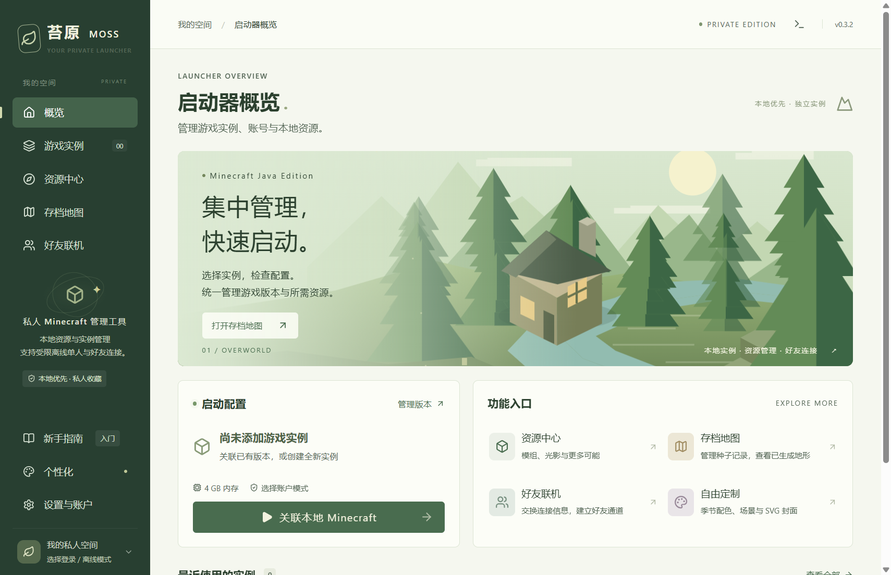
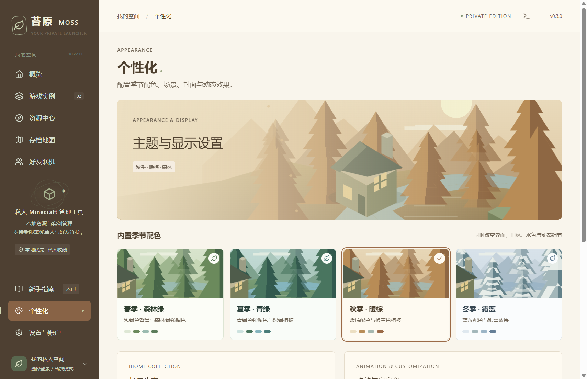
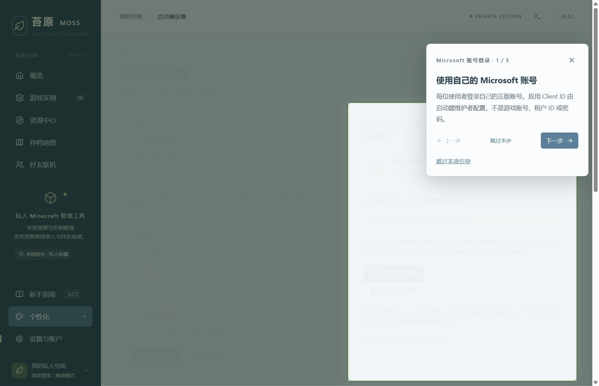

# Moss Launcher · 苔原 MOSS

A private, non-commercial Windows desktop launcher and local instance manager for **Minecraft: Java Edition**.

This public repository provides project information and screenshots for application review. The launcher is intended for personal use and sharing with a small group of friends. Executables, application source code, game files, user data, and authentication caches are not distributed through this repository.

**Current status — 1 November 2026:** private preview, version 0.4.0. The maintainer has received Minecraft application approval and reports successful Microsoft/Minecraft sign-in, game launch, and modpack/mod installation. Version 0.4.0 adds installation-time game preparation with visible progress, Java detection and Temurin installation, resource-version selection, and clearer local-folder management. Individual loader and mod combinations still require their own compatibility testing.

## Application identity

| Item | Value |
| --- | --- |
| Application display name | Moss Launcher |
| Interface name | 苔原 MOSS |
| Maintainer | [Whilechocolate](https://github.com/Whilechocolate) |
| Platform | Windows desktop |
| Client type | Public/native client; no embedded client secret |
| Application (client) ID | `38d0dbb0-e88b-4756-879d-e05322698703` |
| Microsoft account audience | Personal Microsoft accounts |
| Authorization flow | OAuth authorization code flow with PKCE, in the system browser |
| Redirect URI | `http://localhost` with a dynamically assigned loopback port |

The client ID identifies this application and is not an account password or API secret.

## Purpose and features

- Manage separate local game instances and associate an existing Minecraft installation.
- Import supported modpack archives and install their declared resources into a new instance.
- Organize local mods, resource packs, and shaders; check declared dependencies and managed file hashes, with backups for supported repairs.
- Browse resource providers, including Modrinth and a CurseForge adapter that requires the maintainer's API key.
- Customize seasonal colors, biome illustrations, SVG covers, text, and animations.
- Follow optional, interactive tutorials for account sign-in, instance creation, resource installation, and appearance settings.
- View surface terrain from existing local world region files. This does not generate unexplored terrain from a seed alone.
- Use an experimental, manually paired friend connection over WebRTC/TCP. It is disabled in the launcher's offline mode; cross-network connectivity is not guaranteed.

Some features are experimental. Declared mod compatibility checks do not guarantee that every mod combination runs correctly. Authenticated game launch has been reported successful by the maintainer.

## Why Minecraft API access is requested

The launcher needs Minecraft game service API access to exchange a verified Xbox identity for a Minecraft session, verify Java Edition ownership, retrieve the player's Minecraft profile, and launch authenticated sessions for players using their own accounts.

The implemented flow is:

1. The user chooses sign-in in the launcher and selects their own account on Microsoft's website in the system browser.
2. MSAL uses an authorization code with PKCE and a random state, returning through a loopback listener bound to `127.0.0.1`.
3. The launcher exchanges the Microsoft credential with Xbox Live and obtains an XSTS token for Minecraft Services.
4. It calls Minecraft Services authentication, then requests the player's profile and Java Edition entitlements before returning a verified game identity.
5. The resulting Minecraft credential is supplied locally to the game process when launching an authenticated session.

The launcher uses its own application ID. No authenticated Minecraft session is fabricated when a service rejects a request. The separate offline single-player mode uses a local identity, disables the launcher's friend tunnel, and passes Minecraft's multiplayer/chat disabling arguments for supported versions. It cannot join authenticated online-mode servers as a verified player.

## Screenshots

These are captures of the actual private preview UI using an empty or temporary test library. They do not demonstrate a successful authenticated Minecraft login. Screenshots may show different preview revisions.

### Launcher overview

### Seasonal appearance settings

### Interactive account tutorial

## Privacy and review information

See [PRIVACY.md](PRIVACY.md) for credential handling, local storage, and external services. See [AUTHENTICATION.md](AUTHENTICATION.md) for the intended API requests and current approval status.

For application-review correspondence, use the contact email supplied privately in the application review form. Project questions can be filed in this repository's Issues. Do not include passwords, authorization codes, tokens, or credential cache files in public issues.

## 中文说明

苔原 MOSS 是供个人和少量好友使用的非商业 Windows Minecraft Java 启动器。本仓库仅公开项目说明与界面截图，供了解项目及应用审核使用；程序与源码继续私下保存。维护者已收到 Minecraft 应用准入批准，并于 2026-11-01 确认正版登录、游戏启动及资源安装成功。应用准入不表示本产品属于官方产品或获得产品背书。

Moss Launcher is an independent project. It is not an official Minecraft product and is not approved by or associated with Mojang or Microsoft. Minecraft is a trademark of Mojang/Microsoft.
